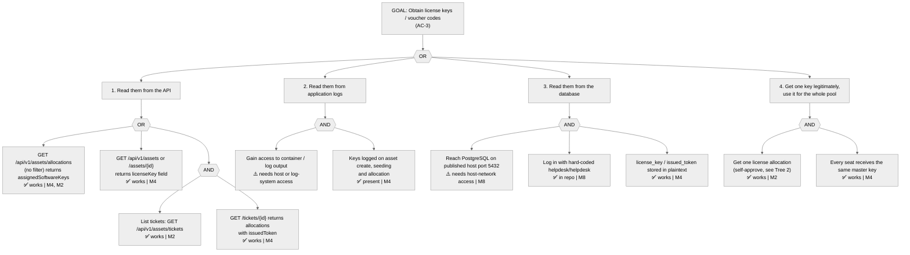
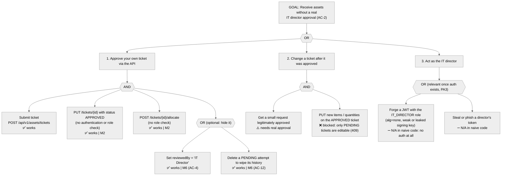
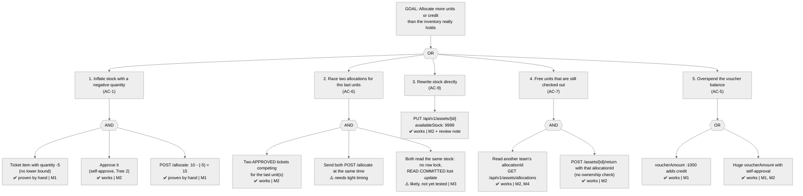
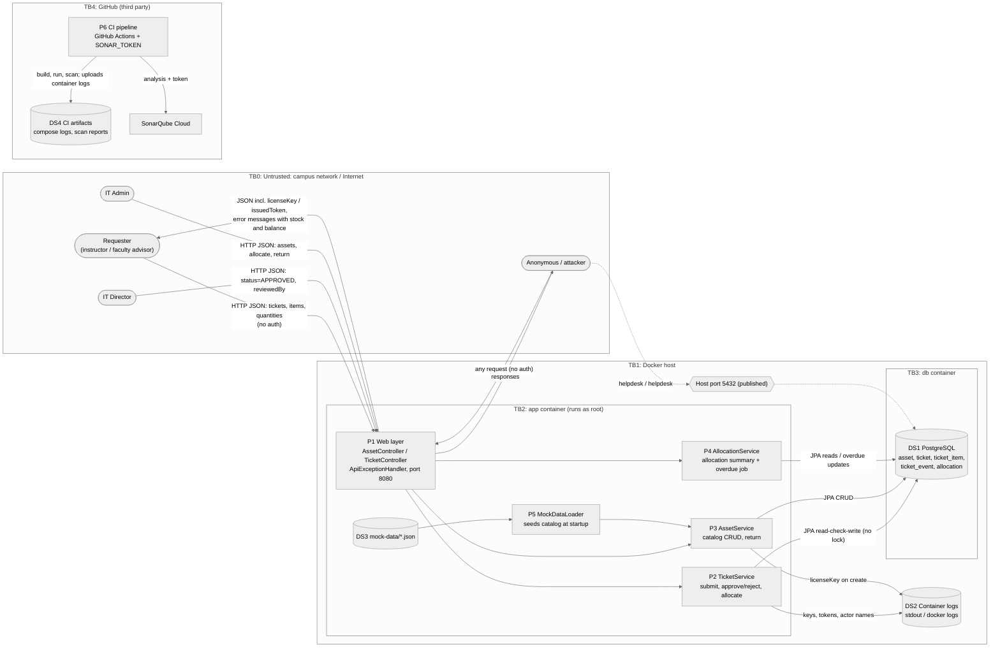

# Security Analysis: Resource Allocation & Help Desk Hub (PA2)

**Service:** Domain 2, Resource Allocation & Help Desk Hub (`ProjectPortalDomainServices.docx`) · **Code analysed:** `PA2/functional-codebase/` (AI-generated naive baseline) · **Author:** Azmeer Hussain

## AI Deliverable Metadata Block

| Item | Value |
|---|---|
| Conceptual AI contribution | **Part 1 (Security requirements): ~90% AI / ~10% human. Part 2 (Abuse cases): ~85% AI / ~15% human** (the student specified the 4 required abuse cases and the fields). **Part 3 (Attack trees): ~85% AI / ~15% human** (the student chose the 3 abuse cases and the format). **Part 4 (Attack surface): ~90% AI / ~10% human** (the student defined the scope). **Part 5 (DFD & STRIDE): ~90% AI / ~10% human** (the student defined the method and required real code examples). Later parts are added below as they are written. |
| Human (student) | Wrote the prompt for each part (multi-turn, part-by-part chaining). Supplied the confirmed flaw set M1–M8 (`sast-triage-report.md`), where the classifications and rationales are the student's. Audits each AI draft (see `.ai_logs/conceptual_journal.md` §3). |
| AI (Claude, `claude-opus-5-5`) | Drafted the text of each part from the student's prompt, the master spec, the generated code and M1–M8. |
| Prompts (verbatim) | [`.ai_logs/pa2-session-log.md`](.ai_logs/pa2-session-log.md), entries PA2-09 onward |

---

## 1. Security Requirements (defensive baseline)

**Prompt (PA2-09):** *"Can you write the security requirements for the Domain 2 service? Use the spec, the code and the M1–M8 flaws we found. Number them SR-1, SR-2, etc., and say which M flaw each one fixes."*

**Roles assumed by these requirements** (derived from the master spec, since the naive code has no roles):

| Role | Who (spec) | Allowed actions |
|---|---|---|
| `REQUESTER` | Instructors and faculty advisors (FR3) | Submit tickets; view, edit and delete **their own** PENDING tickets; view allocations for **their own** course or lab |
| `IT_DIRECTOR` | IT director sign-off (FR4) | Approve or reject tickets; view all tickets and allocations |
| `IT_ADMIN` | IT staff running inventory (FR1, FR2) | Manage the asset catalog; execute `/allocate` on APPROVED tickets; process returns |

### 1.1 Requirements

| ID | Requirement | Fixes | How it can be verified (PA3/PA4) |
|---|---|---|---|
| **SR-1** | **Authentication on every endpoint.** Every `/api/v1/assets/**` route requires a valid JWT signed with an **asymmetric** key (RS256/ES256), with `iss`, `aud` and `exp` checked. Only `/actuator/health` is public. Missing, expired, forged or `alg=none` tokens get `401`. | **M2**, M6 | Call each route with no token, an expired token, a token signed with the wrong key, and `alg=none` → all `401` |
| **SR-2** | **Role-based access control, deny by default.** Each route is limited to the roles in the table above. Any action not explicitly allowed is denied with `403`. | **M2** | A `REQUESTER` token calling PUT approve, `/allocate`, or asset POST/PUT/DELETE → `403` |
| **SR-3** | **Object-level authorization (no BOLA/IDOR).** A `REQUESTER` can read or change only tickets they created and allocations for course/lab IDs in their token claims. Ownership comes from the token, never from request parameters. | **M2**, M4 | Requester A fetches requester B's ticket ID, or `GET /allocations?courseId=<other course>` → `403`/`404` |
| **SR-4** | **Separation of duties for approval vs. allocation (FR4).** Only `IT_DIRECTOR` can approve or reject. Only `IT_ADMIN` can execute `/allocate`, and only on `APPROVED` tickets. The approver cannot be the requester of the same ticket. | **M2**, M6 | Director approving their own ticket → `403`; `/allocate` on a PENDING ticket → `409` |
| **SR-5** | **Server-derived identity and a tamper-evident audit trail.** `requesterName`, `reviewedBy`, `allocatedBy` and every `ticket_event.actor` come from the authenticated principal. Any client-supplied value for these fields is ignored. Audit events are append-only and are **not** deleted when a ticket is deleted. | **M6** | Send `"reviewedBy":"IT Director"` with a different user's token → the stored value is that user's identity; delete a ticket → its events remain |
| **SR-6** | **Strict input validation.** `quantity` is an integer from 1 to a configured maximum (e.g. 50). `voucherAmount` is greater than 0, at most a configured cap, with 2 decimal places. Enums are whitelisted, string fields are length-limited, a ticket has 1–20 items, and unknown JSON fields are rejected. Violations → `400` with no state change. | **M1** | Quantities `-5`, `0`, `1000000` and amounts `-1000`, `0.001` → `400`; stock and balance unchanged (repeat of the PA2 manual test) |
| **SR-7** | **Inventory invariants enforced in the database (defence in depth).** `CHECK (available_stock >= 0 AND available_stock <= total_stock)`, `CHECK (voucher_balance >= 0)`, `CHECK (quantity > 0)`, `NOT NULL` on required columns, and foreign keys `allocation → asset/ticket`, `ticket_item → asset`. | **M1**, M3 | A direct SQL update to negative stock fails; the app returns `409`, not `500` |
| **SR-8** | **Atomic, concurrency-safe allocation.** `/allocate` locks every affected asset row (`SELECT … FOR UPDATE`) or uses optimistic locking (`@Version`) with a bounded retry. All items succeed or none do. A ticket can be allocated **once** (idempotent). | **M3** | Fire N parallel `/allocate` calls for tickets competing for the last unit → exactly one succeeds; stock never below 0 |
| **SR-9** | **No mass assignment on assets.** The asset update API cannot set `availableStock`, `status` or `licenseKey` directly. Status is derived by the server. Stock changes go through dedicated, audited adjustment operations that keep SR-7's invariants. An asset with outstanding allocations cannot be deleted. | M1, M2 *(also covers the student's review note that "you can set the stock or status to anything", which is not one of M1–M8)* | `PUT /assets/{id}` with `availableStock:-1` or `status:AVAILABLE` → ignored or `400`; delete an asset with an active allocation → `409` |
| **SR-10** | **Protection of license keys and voucher codes.** Secret values are **encrypted at rest** (AES-256-GCM, key from the environment or a secret store, not in the repo). They are **never** included in list, detail or summary responses. The owning requester can reveal them only through a dedicated, audited endpoint. Each license allocation issues a unique seat token, not the shared master key. | **M4** | `GET /allocations`, `GET /tickets/{id}` and `GET /assets/{id}` contain no key material; DB dump shows ciphertext; a reveal writes an audit event |
| **SR-11** | **Logging hygiene and security event logging.** Logs never contain license keys, voucher codes, tokens or credentials (mask or omit). Security events are logged with actor and trace ID: login failures, `403`s, approvals, rejections, allocations, returns, secret reveals. | **M4**, M6 | Grep the logs after a full allocate flow → no key material; approvals show the authenticated actor |
| **SR-12** | **Server-enforced workflow state machine.** Only the defined transitions are allowed (PENDING→APPROVED/REJECTED, APPROVED→REJECTED, APPROVED→ALLOCATED via `/allocate` only, ALLOCATED/REJECTED→CLOSED). **APPROVED→REJECTED must release the reservations** the approval created, and reservations expire if not allocated within a configured window. | **M5** | Approve then reject → the asset returns to `AVAILABLE` and reappears in `GET /assets?status=AVAILABLE` |
| **SR-13** | **Safe error handling.** Clients get a generic message, a stable error code and a correlation ID. No internal UUIDs of other objects, stock or balance figures, SQL or stack traces. Details go only to the server log. | **M7** | Trigger insufficient-stock, invalid-transition and not-found errors → the response body has no numbers or IDs beyond the requested resource |
| **SR-14** | **No hard-coded or default credentials.** Database credentials and signing/encryption keys come from environment variables or a secret store, with **no default values**. The service refuses to start if they're missing. PostgreSQL is not published on a host port. | **M8** | Start without `DB_PASSWORD` → startup fails; `docker compose config` shows no literal password; `5432` not exposed |
| **SR-15** | **Least-privilege container.** The runtime image runs as a non-root user with a minimal base image and no build tools. | S4 | `docker exec … id` → non-zero UID; Semgrep `missing-user-entrypoint` clears |
| **SR-16** | **Supply-chain integrity.** CI actions are pinned to full commit SHAs. Dependencies (Spring Boot and its transitive libraries) are kept on supported, patched versions, and dependency scanning runs on every build. | S1, Trivy appendix | Semgrep `mutable-action-tag` clears; Trivy shows no CRITICAL findings with a fix available |
| **SR-17** | **Transport security.** In any non-local deployment the API is served only over HTTPS (TLS 1.2+) and tokens are never sent over plain HTTP. | Baseline (no M; the spec involves high-value tokens) | `curl http://…` refused or redirected; TLS scan |
| **SR-18** | **Abuse and resource limits.** Rate limits on ticket submission, `/allocate` and secret reveal per user; a cap on items per ticket and on page size for list endpoints. | Baseline (no M); limits impact of M1/M3-style abuse | Burst of 100 ticket submissions → `429` after the limit |

### 1.2 Traceability: every confirmed flaw is covered

| Flaw | Covered by |
|---|---|
| M1 Negative quantity / voucher amount (CWE-1284) | SR-6, SR-7, SR-9 |
| M2 No authentication or authorization (CWE-306/862) | SR-1, SR-2, SR-3, SR-4, SR-9 |
| M3 Allocation race condition (CWE-362) | SR-8, SR-7 |
| M4 License keys exposed in responses and logs (CWE-200/532) | SR-10, SR-11, SR-3 |
| M5 Reservation not released on reject (CWE-841) | SR-12 |
| M6 Spoofable approver/actor identity (CWE-290) | SR-5, SR-1, SR-4, SR-11 |
| M7 Verbose error messages (CWE-209) | SR-13 |
| M8 Hard-coded / default DB credentials (CWE-798/1393) | SR-14 |
| S1 Mutable CI action tags (CWE-1357) | SR-16 |
| S4 Container runs as root (CWE-250) | SR-15 |

---

## 2. Abuse Cases (thinking like a malicious user)

**Prompt (PA2-10):** *"Now write the abuse cases. For each one, say who the attacker is, what they want and which endpoint they would use. Include the negative quantity one, approving your own ticket, stealing license keys and faking the approver's name."*

**Attacker profiles**

| Profile | Description | Access they start with |
|---|---|---|
| **A1: Malicious requester** | A student, instructor or faculty advisor who legitimately submits tickets but wants more than they're entitled to | Network access to the API (and, after PA3, a valid REQUESTER token) |
| **A2: Curious or rival user** | Another course or lab member who wants someone else's resources or secrets | Same as A1, but targets objects they don't own |
| **A3: External attacker** | No campus role; reaches the service over the network | Network access only (in the naive code, that's enough for everything) |
| **A4: Insider covering tracks** | A user (or rogue IT staff member) who wants to hide or misattribute what they did | Same API access as above |

**Summary.** "Works today" refers to the naive baseline in `PA2/functional-codebase/`.

| ID | Abuse case | Attacker | What they want | Endpoint(s) | Works today? | Flaw | Prevented by |
|---|---|---|---|---|---|---|---|
| **AC-1** | **Inflate inventory with a negative quantity** | A1 | Fake extra stock (or voucher credit) so more allocations go through than really exist | `POST /api/v1/assets/tickets` → `PUT /tickets/{id}` → `POST /tickets/{id}/allocate` | ✅ **Yes, proven by hand** (laptops 10 → 15, `PA2/evidence/`) | M1 | SR-6, SR-7 |
| **AC-2** | **Approve your own ticket** | A1 | Skip the IT director sign-off and get hardware or credits without review | `PUT /api/v1/assets/tickets/{id}` with `{"status":"APPROVED"}`, then `POST /tickets/{id}/allocate` | ✅ Yes, no authentication or role check | M2 | SR-1, SR-2, SR-4 |
| **AC-3** | **Steal license keys and voucher codes** | A2, A3 | Harvest paid software keys and cloud credit codes to use or resell | `GET /api/v1/assets/allocations` (returns every issued key in `assignedSoftwareKeys`), `GET /api/v1/assets` and `GET /assets/{id}` (`licenseKey` field), `GET /tickets/{id}` (`issuedToken`); also the application logs | ✅ Yes, keys appear in responses and logs | M4 (+ M2) | SR-10, SR-11, SR-3 |
| **AC-4** | **Fake the approver's name** | A1, A4 | Make a self-approval look like the IT director signed off, so the audit history blames or credits someone else | `PUT /api/v1/assets/tickets/{id}` with `"reviewedBy":"IT Director"`; `POST /tickets/{id}/allocate` with `"allocatedBy":"…"` | ✅ Yes, names are stored exactly as typed | M6 | SR-5, SR-1 |
| **AC-5** | **Drain the cloud-credit voucher pool** | A1 | Allocate a very large `voucherAmount` to their own course, exhausting the department's credits | `POST /tickets` (huge `voucherAmount`) → self-approve (AC-2) → `POST /tickets/{id}/allocate` | ✅ Yes, no upper limit and self-approval works | M1, M2 | SR-6, SR-2, SR-4, SR-18 |
| **AC-6** | **Over-allocate the last units with a race** | A1 (two accounts or two tabs) | Get more units than exist by allocating two approved tickets at the same moment | Two parallel `POST /api/v1/assets/tickets/{id}/allocate` calls | ⚠️ Likely (no row lock; READ COMMITTED lost update). Not yet exploited by hand. | M3 | SR-8, SR-7 |
| **AC-7** | **Return someone else's device** | A2 | Mark another team's checked-out laptop as returned, putting the unit back in the pool and clearing its overdue flag, so it can be allocated again while it's still physically out | `POST /api/v1/assets/{asset_id}/return` with `{"allocationId": "<victim allocation>"}` (IDs come from `GET /allocations`) | ✅ Yes, no ownership check on return | M2 (BOLA) | SR-3, SR-2 |
| **AC-8** | **Lock up assets by abusing the workflow** | A2 | Make an asset look unavailable by approving and then rejecting a ticket for it, so it stays `RESERVED` and drops out of the "available" catalog | `PUT /tickets/{id}` APPROVED → `PUT /tickets/{id}` REJECTED | ✅ Yes, the reservation is never released | M5 (+ M2) | SR-12, SR-2 |
| **AC-9** | **Rewrite inventory directly** | A1, A3 | Set `availableStock` or `status` to any value (e.g. 9999, or mark a busy asset AVAILABLE), or delete an asset that still has active allocations | `PUT /api/v1/assets/{asset_id}`, `DELETE /api/v1/assets/{asset_id}` | ✅ Yes, no field restrictions or delete checks | M2 (+ student review note) | SR-9, SR-2, SR-7 |
| **AC-10** | **Map stock and balances from error messages** | A3 | Learn exact inventory and voucher balances (to time attacks like AC-5 and AC-6) without asset access, by sending oversized requests and reading the `409` text | `POST /tickets/{id}/allocate` (the error contains "available N, requested M" / "balance X") | ✅ Yes, the error body includes the figures | M7 | SR-13 |
| **AC-11** | **Go straight to the database** | A3 (on the host's network) | Read all tables, including plaintext license keys, or change inventory, without going through the API | PostgreSQL on host port **5432** with the hardcoded `helpdesk` / `helpdesk` credentials | ✅ Yes, the port is published and the password is in the repo | M8 | SR-14 |
| **AC-12** | **Erase traces of a failed attempt** | A4 | Remove evidence of a suspicious request by deleting the PENDING ticket, which also deletes its event history | `DELETE /api/v1/assets/tickets/{id}` | ✅ Yes (PENDING tickets only), the events are deleted too | M6 | SR-5 |

**Abuse case scenarios (the four the student required)**

- **AC-1: Negative quantity.** A requester submits a ticket asking for `quantity: -5` laptops. Because the naive code allows anyone to approve (AC-2), they approve it themselves, then call `/allocate`. The allocation check `available < quantity` passes (10 < −5 is false), and the update computes `10 − (−5) = 15`. Inventory now claims 15 laptops out of 10, and later legitimate allocations draw on stock that doesn't exist. The same trick with `voucherAmount: -1000` adds $1,000 of cloud credit.
- **AC-2: Approve your own ticket.** The spec requires IT director sign-off (FR4), but approval is just `PUT /tickets/{id}` with `"status":"APPROVED"`, and the API never checks who sent it. The requester submits, approves and allocates in three calls, and the separation of approval from allocation is defeated.
- **AC-3: Steal license keys.** Anyone calls `GET /api/v1/assets/allocations` with no filters and receives every active allocation, including `assignedSoftwareKeys`. `GET /api/v1/assets` returns the master `licenseKey` of every license pool. Anyone with log access sees the keys printed by `AssetService` and `TicketService`. Because every seat gets the same master key, one leak exposes the whole pool.
- **AC-4: Fake the approver.** The attacker self-approves (AC-2) with `"reviewedBy":"IT Director"`. The ticket, its `ticket_event` history and `GET /tickets/{id}` all show the IT director as approver, so an audit would blame the wrong person and the abuse is hidden.

## 3. Attack Trees (≥ 3 abuse cases)

**Prompt (PA2-11):** *"Make attack trees for three of the abuse cases: stealing license keys, approving your own ticket and overspending stock. Use Mermaid."*

**Legend:** **OR** = any child achieves the parent · **AND** = all children are required · ✅ works on the naive code · ⚠️ works but needs extra access or timing · ❌ blocked by the current code · ➖ not applicable yet · `Mx` = confirmed flaw from `sast-triage-report.md`

### Tree 1: Steal license keys and voucher codes (AC-3)

**Cheapest path:** branch 1, a single unauthenticated `GET /api/v1/assets/allocations`. One HTTP request, no special access. Branch 4 shows why a single leak is a pool-wide breach: every seat shares the master key.
**Cut by:** SR-10 (never return or log keys; encrypt at rest; unique per-seat tokens), SR-1/SR-3 (authenticated, owner-scoped access), SR-11 (log hygiene), SR-14 (no hard-coded DB credentials, no published DB port).

### Tree 2: Approve your own ticket (AC-2)

**Cheapest path:** branch 1, three API calls (submit, approve, allocate), optionally disguised with a fake `reviewedBy` (AC-4). Branch 2 is **already blocked** by the naive code (only PENDING tickets can be edited). Branch 3 is not applicable yet, but it becomes **the** path to defend once JWT authentication is added in PA3.
**Cut by:** SR-1, SR-2, SR-4 (authentication, role checks, separation of duties so the approver cannot be the requester), SR-5 (identity from the token, append-only history). For branch 3 after PA3: asymmetric signing with `alg` pinned, plus key management (SR-1, SR-14).

### Tree 3: Overspend stock, i.e. allocate more than exists (AC-1, AC-5, AC-6, AC-7, AC-9)

**Cheapest path:** branch 3, a single `PUT /assets/{id}` setting `availableStock`. Branch 1 is the **proven** path (`PA2/evidence/`). Branch 2 (the race) is the only one that survives fixing input validation and authorization, which is why SR-8 (row locking) and SR-7 (DB `CHECK` constraints) are needed as separate controls.
**Cut by:** SR-6 (quantity and amount bounds), SR-7 (DB invariants), SR-8 (locking and idempotent allocate), SR-9 (no direct stock or status writes), SR-3 (ownership check on return), SR-2/SR-4 (no self-approval).

## 4. Attack Surface Map

**Prompt (PA2-12):** *"Map out the attack surface. List all 8 endpoints and who should be able to use them, plus the database port, the logs, the Docker container and the CI pipeline."*

> **Note on "8 endpoints":** the master spec defines **7 routes** (14 method + route operations). The 8th network entry point is the Spring Boot Actuator (`/actuator/health`, `/actuator/info`), which the generated code exposes. All 8 are listed below.

### 4.1 Network entry points (HTTP, port 8080)

"Should use" = the intended access from SR-2/SR-3. "Can use today" = the naive baseline.

| # | Route | Methods | Input accepted | Should use | Can use today | Sensitive data / effect | Flaws | Controls |
|---|---|---|---|---|---|---|---|---|
| E1 | `/api/v1/assets` | POST | JSON `AssetRequest` (name, category, stock, status, licenseKey, voucherBalance…) | `IT_ADMIN` | **Anyone** | Creates inventory and stores secret keys | M2, M4 (key logged) | SR-1, SR-2, SR-10, SR-11 |
| | | GET | Query: `status`, `category`, `departmentProgram`, `courseId`, `labId`, `q` | All authenticated roles (keys hidden) | **Anyone** | Returns `licenseKey` and `voucherBalance` of every asset | M2, M4 | SR-1, SR-10 |
| E2 | `/api/v1/assets/{asset_id}` | GET / PUT / DELETE | Path UUID; PUT body `AssetRequest` | GET: all roles · PUT/DELETE: `IT_ADMIN` | **Anyone** | PUT can set `availableStock` and `status` directly; DELETE ignores active allocations | M2, M4, review note | SR-2, SR-9, SR-10 |
| E3 | `/api/v1/assets/{asset_id}/return` | POST | Path UUID; optional `allocationId` | `IT_ADMIN` (or the owning requester, if policy allows) | **Anyone, for any allocation** | Puts units back in stock and clears overdue status | M2 (BOLA, AC-7) | SR-2, SR-3 |
| E4 | `/api/v1/assets/allocations` | GET | Query: `courseId`, `labId` (both optional) | `REQUESTER` (own course/lab only), `IT_DIRECTOR`, `IT_ADMIN` | **Anyone, all courses/labs** | Returns `assignedSoftwareKeys` and every `issuedToken` | M2, M4 (AC-3) | SR-1, SR-3, SR-10 |
| E5 | `/api/v1/assets/tickets` | POST / GET | POST body `TicketRequest` (items, quantities, voucher amounts, requester/role text); GET filters | POST: `REQUESTER` · GET: own tickets (requester) or all (director/admin) | **Anyone, all tickets** | Creates requests with unbounded quantities; lists every ticket | M1, M2, M6 | SR-1, SR-3, SR-5, SR-6, SR-18 |
| E6 | `/api/v1/assets/tickets/{ticket_id}` | GET / PUT / DELETE | Path UUID; PUT body with `status`, `reviewedBy`, items | GET: owner, director, admin · PUT content/DELETE: owner (PENDING only) · PUT status: `IT_DIRECTOR` | **Anyone, including self-approval** | GET returns allocations with `issuedToken`; PUT approves or rejects; DELETE wipes event history | M2, M4, M5, M6, M7 | SR-2, SR-4, SR-5, SR-10, SR-12, SR-13 |
| E7 | `/api/v1/assets/tickets/{ticket_id}/allocate` | POST | Path UUID; optional `allocatedBy` | `IT_ADMIN` only, APPROVED tickets only | **Anyone** | Deducts inventory and issues keys and tokens; race-prone; errors leak stock/balance | M1, M2, M3, M6, M7 | SR-2, SR-4, SR-6, SR-7, SR-8, SR-13 |
| E8 | `/actuator/health`, `/actuator/info` | GET | None | Orchestrator / monitoring (health may stay public; `info` should not) | **Anyone** | Low: status only (other actuator endpoints are not exposed) | n/a | Keep exposure limited to `health`; SR-17 |

### 4.2 Non-HTTP attack surface

| # | Surface | Exposure today | Who should have access | Risk | Flaws | Controls |
|---|---|---|---|---|---|---|
| D1 | **PostgreSQL** (container `db`, port **5432**) | Published on the **host** (`"5432:5432"`); credentials `helpdesk` / `helpdesk` in `docker-compose.yml` (public repo) | Only the `app` container over the internal Docker network | Full read/write of every table, including plaintext `license_key` / `issued_token` (AC-11) | M8, M4 | SR-14 (no host port, secret-managed creds), SR-10 (encryption at rest), SR-7 |
| D2 | **Application logs** (stdout → `docker compose logs`, CI log artifacts) | License keys logged on create, seed and allocation; free-text actor names logged as fact; CI uploads container logs as artifacts | Operators / IT admins only | Key disclosure to anyone with log or CI-artifact access; misleading audit records | M4, M6 | SR-11 (no secrets in logs, security event logging), SR-5 |
| D3 | **Docker container and image** (`app`, port 8080) | Runs as **root**; Spring Boot 3.3.5 with 89 known library CVEs (incl. Tomcat CVE-2025-24813 CRITICAL); config through environment variables | Deployment pipeline only | A web-layer exploit gets root in the container; reading env vars exposes DB credentials | S4, M8, Trivy appendix | SR-15, SR-16, SR-14 |
| D4 | **CI pipeline** (GitHub Actions `devsecops.yml`) | Triggered by push, PR and manual dispatch (`semgrep_target` input); actions pinned by **mutable tags**; holds `SONAR_TOKEN`; `security-events: write`; uploads logs and reports as artifacts | Repo maintainers (write access) | Supply-chain compromise of a tagged action could exfiltrate `SONAR_TOKEN` or alter build output; an input injection risk existed (S2, fixed) | S1, S2 (fixed) | SR-16 (SHA pinning, least-privilege `permissions`), keep inputs out of `run:` interpolation |
| D5 | **Source repository** (public GitHub) | Contains compose credentials and fake demo keys; the full code is public | Anyone can read; maintainers write | Attackers learn credentials and logic paths (the basis for D1 and AC-11) | M8 | SR-14, secret scanning (Semgrep `p/secrets`) |
| D6 | **Scheduled overdue job** (internal, every 15 min) | No network entry; acts on DB state | System only | Low; relies on data integrity (manipulated by E3/E2) | n/a | SR-7, SR-3 |

### 4.3 Trust boundaries

1. **Internet / campus network → API (port 8080):** today **no** authentication; everything in 4.1 is reachable without credentials. This is the main boundary to harden (SR-1…SR-4).
2. **API → PostgreSQL:** should be internal-only, but is **also reachable from the host** (D1).
3. **Container → host:** the process runs as root (D3).
4. **GitHub (third-party actions, SonarQube Cloud) → CI runner:** trust is placed in mutable action tags and an external token (D4).
5. **Mock data / external directory → service:** course, lab and requester IDs are free text that is never verified (the `academic-units.json` stand-in), so requester identity and role are unverified (M6).

**Largest exposure today:** E4 and E7 (anyone can harvest keys or run allocations), and D1 (direct database access with credentials published in the repo).

## 5. Data Flow Diagram & STRIDE (every component)

**Prompt (PA2-13):** *"Draw a data flow diagram in Mermaid that shows the trust boundaries. Then do STRIDE for every component, using real examples from our code."*

### 5.1 Data flow diagram (Level 1)

Processes `P1–P6`, data stores `DS1–DS4`, external entities (rounded nodes), trust boundaries `TB0–TB4` (subgraphs). Dotted line = an unintended path that exists today.

| Boundary | Separates | Crossing flows |
|---|---|---|
| **TB0 → TB2** | Untrusted users ↔ application | All HTTP requests and responses on port 8080 (**no authentication, no TLS**) |
| **TB2 ↔ TB3** | Application ↔ database | JDBC over the internal Docker network |
| **TB0 → TB3 (via host)** | Untrusted network ↔ database | **Published port 5432** with credentials from the repo (unintended) |
| **TB2 → TB1** | Container ↔ host | Root process; stdout logs collected on the host |
| **TB4 ↔ repo** | Third-party CI/SaaS ↔ project | Mutable-tag actions, `SONAR_TOKEN`, uploaded log artifacts |

### 5.2 STRIDE matrix

● = applicable threat with a real example in our code (see 5.3) · ○ = low / not meaningful for this component

| Component | S | T | R | I | D | E |
|---|---|---|---|---|---|---|
| External entities (requester, director, admin) | ● | ○ | ● | ○ | ○ | ○ |
| P1 Web layer (controllers, exception handler) | ● | ● | ● | ● | ● | ● |
| P2 TicketService | ● | ● | ● | ● | ● | ● |
| P3 AssetService | ○ | ● | ● | ● | ● | ● |
| P4 AllocationService + overdue job | ○ | ● | ○ | ● | ● | ○ |
| P5 MockDataLoader + DS3 mock data | ○ | ● | ○ | ● | ○ | ○ |
| DS1 PostgreSQL | ● | ● | ● | ● | ● | ● |
| DS2 Container logs | ○ | ● | ● | ● | ● | ○ |
| Data flow: client ↔ API (HTTP) | ● | ● | ○ | ● | ○ | ○ |
| TB2 app container / image | ○ | ● | ○ | ● | ○ | ● |
| P6 CI pipeline + DS4 artifacts | ● | ● | ○ | ● | ○ | ● |

### 5.3 STRIDE per component, with examples from the code

Line numbers refer to `PA2/functional-codebase/src/main/java/edu/bu/cs763/helpdesk/` unless another file is named.

**External entities**
- **S:** Anyone can claim to be an instructor or the IT director: `requesterName`/`requesterRole` in `TicketRequest` and `reviewedBy` are just strings. *(M6, AC-4)*
- **R:** A requester can deny submitting or self-approving a ticket, because nothing ties a request to an authenticated identity. *(M2, M6)*

**P1 Web layer: `AssetController`, `TicketController`, `ApiExceptionHandler`**
- **S:** No authentication on any route. Every caller is anonymous and indistinguishable. *(M2)*
- **T:** Mass assignment. `PUT /assets/{id}` binds `AssetRequest`, so a caller can set `availableStock`, `status` and `licenseKey` directly (`AssetService.apply()`). *(AC-9)*
- **R:** Requests are not logged with an identity. The only record is the service-level log with caller-supplied names.
- **I:** Entities are serialised directly, so `Asset.licenseKey` and `Allocation.issuedToken` leak in GET responses. `ApiExceptionHandler.java:43` returns raw exception messages with stock and balance figures. *(M4, M7, AC-10)*
- **D:** List endpoints have no paging: `AssetService.search()` (`service/AssetService.java:100`) and `TicketService.search()` (`:124`) return every row. Ticket item lists are unbounded.
- **E:** Any caller performs `IT_ADMIN` and `IT_DIRECTOR` actions (create assets, approve, allocate). *(M2, AC-2)*

**P2 `TicketService` (submit / review / allocate)**
- **S:** `ticket.setReviewedBy(request.reviewedBy())` (`TicketService.java:200`) and `setAllocatedBy(allocatedBy)` (`:301`) store any name the caller sends. *(M6)*
- **T:** Negative quantity or voucher amount inflates inventory: `available < quantity` / `available - quantity` (`:277–281`), `remaining.signum()` (`:268–272`). Proven 10 → 15. Approval sets `RESERVED` (`:213`), and rejection never clears it. *(M1, M5, AC-1, AC-8)*
- **R:** History rows (`ticket_event`) record the caller-supplied actor, and deleting a PENDING ticket deletes its history (`eventRepository.deleteByTicketId`, `:230`). *(M6, AC-12)*
- **I:** Issued license tokens are logged (`log.info("Allocated … token={}")`, `:295`). `ConflictException` messages include asset IDs, available stock and voucher balance. *(M4, M7)*
- **D:** The read-check-write in `allocate()` with no lock lets concurrent requests corrupt stock (lost update), and a huge item list makes one transaction lock many rows. *(M3, AC-6)*
- **E:** `transition()` (`:192`) lets anyone move PENDING → APPROVED, and `allocate()` has no role check, so the separation of duties in FR4 is gone. *(M2, AC-2)*

**P3 `AssetService` (catalog, return)**
- **T:** `apply()` copies any non-null field onto the entity. `returnAsset()` accepts any `allocationId` with no ownership check, so another team's device can be "returned" while still checked out. `delete()` removes assets that have active allocations. *(AC-7, AC-9)*
- **R:** `log.info("Asset updated id={}")` (`:113`) records no actor and no before/after values.
- **I:** `log.info("Asset created … licenseKey={}")` (`:70`) writes the master key to the logs. *(M4)*
- **D:** Deleting an in-use asset leaves allocations pointing at a missing asset, which breaks returns for that device.
- **E:** Inherited from P1: anonymous callers perform admin-only catalog changes.

**P4 `AllocationService` (summary + overdue job)**
- **T:** The overdue job (`markOverdue()`) trusts `dueAt` and stock data that P2/P3 let attackers distort.
- **I:** `activeFor()` builds `assignedSoftwareKeys` (`AllocationService.java:67`) and returns every key to any caller when no filter is given. *(M4, AC-3)*
- **D:** `findByStatusIn(...)` (`:52`) loads **all** active allocations into memory and filters in Java on every request.

**P5 `MockDataLoader` + DS3 mock data**
- **T:** Seed data is baked into the image (`mock-data/seed-assets.json`), so whoever controls the image controls the initial inventory.
- **I:** Seeding goes through `AssetService.create()`, which logs every seeded license key at startup (student review note). *(M4)*

**DS1 PostgreSQL**
- **S:** Anyone who can reach host port 5432 can log in as `helpdesk` / `helpdesk` (`docker-compose.yml:19, 21`). *(M8, AC-11)*
- **T:** `schema.sql` has no `CHECK` constraints, no `NOT NULL` on required columns and no FK from `allocation` to `asset`, so negative stock is stored without complaint. *(M1, SR-7)*
- **R:** No database audit trail; direct SQL changes are invisible to the application.
- **I:** `license_key` and `issued_token` are stored in **plaintext**. *(M4)*
- **D:** The published port is open to connection exhaustion and password guessing.
- **E:** The `postgres` image makes `POSTGRES_USER` (`helpdesk`) a **superuser**, so the app account and any attacker using it have full database privileges.

**DS2 Container logs**
- **T:** **Log injection (CWE-117):** user-controlled strings (`requesterName`, `courseId`, …) are logged raw (`TicketService.java:96`), so a value containing a newline can forge extra log lines. *(Found during this analysis; not in M1–M8.)*
- **R:** Logs present caller-typed names as fact (`by=IT Director`). *(M6)*
- **I:** License keys and tokens are in the logs (P2, P3, P5). *(M4)*
- **D:** No rate limiting, so request floods also flood the logs and disk.

**Data flow: client ↔ API**
- **S / T / I:** Plain HTTP on port 8080 with no TLS. Tokens and keys in responses can be sniffed or altered in transit on a shared network. *(SR-17)*

**TB2 app container / image**
- **T:** Base images are referenced by mutable tags (`maven:3.9.9-eclipse-temurin-21`, `eclipse-temurin:21-jre-alpine`), so a re-pushed tag changes what gets built.
- **I:** The DB password sits in plain container environment variables (`docker inspect`).
- **E:** No `USER` instruction, so the JVM runs as **root** (Semgrep S4). Combined with library CVEs such as Tomcat CVE-2025-24813 (Trivy appendix), a web exploit gets root in the container.

**P6 CI pipeline + DS4 artifacts**
- **S:** Actions pinned by mutable tags (`@v4`) can be silently swapped for malicious code that impersonates the real action. *(S1)*
- **T:** Workflow-dispatch input was interpolated into a shell script (S2, now fixed by passing it through an env var).
- **I:** `SONAR_TOKEN` is available to third-party actions in that job. The smoke test (`smoke-test.sh:38–40`) prints allocation responses, and the job uploads container logs as artifacts, so issued tokens and seeded keys end up in CI logs and artifacts. *(M4)*
- **E:** Workflow `permissions` include `security-events: write`. A compromised action inherits the job's token scope.

### 5.4 New issues found during STRIDE (not in M1–M8)
These came out of this analysis and should be **reviewed by the student** before deciding whether to add them to the triage ledger (adding them would extend the PA3 scope):
1. **Log injection (CWE-117)**: raw user strings in log statements (`TicketService.java:96` and others).
2. **Database superuser (CWE-250)**: the app connects as the PostgreSQL superuser created by `POSTGRES_USER`.
3. **No paging / in-memory filtering (CWE-770)**: unbounded list endpoints and `findByStatusIn` loading all allocations.
4. **No TLS (CWE-319)**: plain HTTP for responses that contain license keys.
5. **Keys and tokens in CI logs and artifacts (CWE-532)**: the smoke test and log artifacts.

## 6. Proposed Mitigations
*(pending)*
