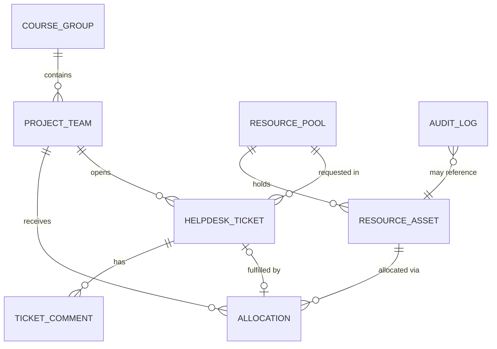

# spec.md — Resource Allocation & Help Desk Hub

**Course:** CS763 Secure Software Development (BU MET) · **Project Portal (PP) Domain 2**
**Author:** Azmeer Hussain · **Version:** 1.0 (Project Assignment 1) · **Date:** 2026-11-02

---

## AI Usage Log (mandatory disclosure)

| Item | Value |
|---|---|
| Conceptual AI contribution | **85% AI drafted / 15% human** (human chose the domain, the tech stack and the scope; reviewed and approved the structure) |
| AI tool | Claude (Anthropic) agentic session (Claude Code-based harness), model `claude-opus-5-5` (see `Agent_environment.md`) |
| Chat / session link | https://claude.ai/code/session_01VYTSL9tbQAUzzMVpp9wZR6 |

Exact prompts typed by the student (verbatim, typos kept):

1. "ive given you access to a folder that has a project in it for one of my classes, before youdo anything just read through it an get an understanding of what the project is asking. then give me a short understanding too cause its too long for m eto read"
2. "so lets set up the stuff that needs to be done for week 1? its dues 6am nov 3rd so i only have today to wkron it. what do you need from me?"
3. "i think we only do the first deiveryably and nthing extra. yes on the stack. go with the optioins that give me the least work and follow all acedemic integrity rules / ll open chrome so you have access just open all necesasry pages and ill log into them"
4. "im reading through the ai usage part, is it supposed to be 95% generated? in terms of the isntructions?"
5. "okay sweet so what am i supposed to do next? just make sure you go through the doc and follow all the urles to the t cause this professor is very anal about that"

(Status messages that contained no instructions, such as "okay the github is connecctd", are in the full export: `docs/ai-history/claude-session-export.md`.)

The agent derived this spec from the official Domain 2 description in `CS763_ProjectDescription.docx`:
> "This service handles the distribution of critical project assets, logging tracking parameters, software license keys, and cloud credit vouchers across active course groups and student project teams."

---

## 1. Purpose and scope

The **Resource Allocation & Help Desk Hub** (RAHH) is an isolated, single-tenant backend REST service of the campus Project Portal. It:

1. Keeps an inventory of **project assets** in typed pools: software **license keys**, **cloud credit vouchers**, and **tracking parameters** (e.g. analytics/tracking IDs, API quota tokens issued to teams).
2. **Allocates** individual assets to **student project teams** inside **course groups**, and supports revocation, expiry and re-allocation.
3. Runs a lightweight **help desk**: teams open tickets (e.g. "we need 2 more AWS credit vouchers", "license key not working"); staff triage, comment, and fulfil tickets — fulfilment of a resource-request ticket creates an allocation.
4. Writes an **audit log** of every allocation, revocation, secret reveal and ticket state change.

**Out of scope:** user management/login (identity is mocked in Phase 1; JWT auth is added in Phase 3), frontend UI, communication with any other student's PP service.

### Isolation rule
Per the course rules, the service talks **only** to its own PostgreSQL instance. Data that would normally come from other campus systems (students, instructors, course groups, project teams) is provided as **local static mock data** (§6) loaded at startup.

## 2. Technology stack

| Layer | Choice |
|---|---|
| Language / runtime | Java 21 (Eclipse Temurin) |
| Framework | Spring Boot 3.3 (Web, Data JPA, Validation, Actuator) |
| Build | Maven 3.9 |
| Database | PostgreSQL 16 (H2 in-memory for unit tests only) |
| Packaging | Multi-stage Docker image + Docker Compose (app + db) |
| CI/CD | GitHub Actions: build/test → Docker build + smoke test → Trivy → Semgrep → SonarQube Cloud |

## 3. Actors and roles

Identity in Phase 1 is supplied by the request header `X-Mock-User-Id`, resolved against `mock-data/users.json`.

| Role | Description | Typical permissions (intended) |
|---|---|---|
| `STUDENT` | Member of one or more project teams | View own team's allocations, open/comment on own team's tickets |
| `TA` | Teaching assistant for a course group | Triage tickets in their course group, allocate from pools |
| `INSTRUCTOR` | Owns a course group | Everything a TA can do + revoke allocations, view audit log for their course |
| `ADMIN` | Portal IT staff | Manage pools and assets, full audit log |

## 4. Data model

### 4.1 Entity–relationship diagram



`COURSE_GROUP`, `PROJECT_TEAM` and users are **mock (read-only)** entities loaded from JSON; the rest are persisted in PostgreSQL.

### 4.2 Tables (PostgreSQL)

**resource_pool**
| Column | Type | Constraints |
|---|---|---|
| id | UUID | PK |
| name | VARCHAR(120) | NOT NULL, UNIQUE |
| type | VARCHAR(30) | NOT NULL — `LICENSE_KEY` \| `CLOUD_CREDIT_VOUCHER` \| `TRACKING_PARAMETER` |
| vendor | VARCHAR(120) | e.g. "JetBrains", "AWS Educate" |
| course_group_id | VARCHAR(40) | NULL = campus-wide pool, else restricted to one course group |
| default_value_amount | NUMERIC(10,2) | credit value for vouchers (USD), NULL otherwise |
| expires_at | TIMESTAMPTZ | NULL = no pool expiry |
| created_by | VARCHAR(40) | NOT NULL (mock user id) |
| created_at / updated_at | TIMESTAMPTZ | NOT NULL |

**resource_asset**
| Column | Type | Constraints |
|---|---|---|
| id | UUID | PK |
| pool_id | UUID | FK → resource_pool.id, NOT NULL |
| secret_value | TEXT | NOT NULL — the license key / voucher code / tracking parameter value |
| label | VARCHAR(120) | non-secret display label, e.g. "IntelliJ seat #14" |
| value_amount | NUMERIC(10,2) | voucher credit, NULL for non-vouchers |
| status | VARCHAR(20) | `AVAILABLE` \| `ALLOCATED` \| `REVOKED` \| `EXPIRED` |
| expires_at | TIMESTAMPTZ | NULL allowed |
| created_at | TIMESTAMPTZ | NOT NULL |

**allocation**
| Column | Type | Constraints |
|---|---|---|
| id | UUID | PK |
| asset_id | UUID | FK → resource_asset.id, NOT NULL |
| team_id | VARCHAR(40) | NOT NULL (mock team id) |
| ticket_id | UUID | FK → helpdesk_ticket.id, NULL |
| allocated_by | VARCHAR(40) | NOT NULL |
| justification | VARCHAR(500) | |
| status | VARCHAR(20) | `ACTIVE` \| `REVOKED` \| `EXPIRED` |
| allocated_at | TIMESTAMPTZ | NOT NULL |
| revoked_at | TIMESTAMPTZ | NULL |
| revoked_by / revoke_reason | VARCHAR | NULL |

Unique partial index: one `ACTIVE` allocation per `asset_id`.

**helpdesk_ticket**
| Column | Type | Constraints |
|---|---|---|
| id | UUID | PK |
| ticket_number | BIGSERIAL | human-friendly number, UNIQUE |
| team_id | VARCHAR(40) | NOT NULL |
| requester_id | VARCHAR(40) | NOT NULL |
| category | VARCHAR(30) | `RESOURCE_REQUEST` \| `ASSET_PROBLEM` \| `ACCESS_ISSUE` \| `GENERAL` |
| subject | VARCHAR(150) | NOT NULL |
| description | TEXT | NOT NULL |
| requested_pool_id | UUID | FK → resource_pool.id, required when category = RESOURCE_REQUEST |
| requested_quantity | INT | default 1 |
| priority | VARCHAR(10) | `LOW` \| `MEDIUM` \| `HIGH` \| `URGENT` |
| status | VARCHAR(20) | `OPEN` \| `IN_PROGRESS` \| `WAITING_ON_REQUESTER` \| `RESOLVED` \| `CLOSED` |
| assignee_id | VARCHAR(40) | NULL |
| created_at / updated_at / resolved_at | TIMESTAMPTZ | |

**ticket_comment**
| Column | Type | Constraints |
|---|---|---|
| id | UUID | PK |
| ticket_id | UUID | FK → helpdesk_ticket.id |
| author_id | VARCHAR(40) | NOT NULL |
| body | TEXT | NOT NULL |
| internal | BOOLEAN | staff-only note when true |
| created_at | TIMESTAMPTZ | NOT NULL |

**audit_log**
| Column | Type | Constraints |
|---|---|---|
| id | BIGSERIAL | PK |
| actor_id | VARCHAR(40) | NOT NULL |
| action | VARCHAR(50) | e.g. `ALLOCATION_CREATED`, `SECRET_REVEALED`, `TICKET_STATUS_CHANGED` |
| entity_type | VARCHAR(40) | |
| entity_id | VARCHAR(64) | |
| details | JSONB | |
| created_at | TIMESTAMPTZ | NOT NULL |

### 4.3 State machines

- **Asset:** `AVAILABLE → ALLOCATED → (REVOKED → AVAILABLE)`; any state → `EXPIRED` when `expires_at` passes.
- **Ticket:** `OPEN → IN_PROGRESS → (WAITING_ON_REQUESTER ↔ IN_PROGRESS) → RESOLVED → CLOSED`; `RESOLVED → IN_PROGRESS` allowed (reopen) within 7 days.

## 5. REST API

Base path: `/api/v1` · Content type: `application/json` · Errors: RFC 7807 `application/problem+json`.

### 5.1 Endpoint summary

| # | Method | Path | Purpose | Intended roles |
|---|---|---|---|---|
| 1 | GET | `/actuator/health` | Liveness/readiness probe | public |
| 2 | GET | `/api/v1/ping` | Simple version/heartbeat | public |
| 3 | GET | `/api/v1/course-groups` | List course groups (mock) | all |
| 4 | GET | `/api/v1/course-groups/{courseGroupId}/teams` | Teams in a course group (mock) | all |
| 5 | GET | `/api/v1/teams/{teamId}` | Team detail incl. members (mock) | all |
| 6 | GET | `/api/v1/resource-pools` | List pools with availability counts; filters `type`, `courseGroupId` | all |
| 7 | POST | `/api/v1/resource-pools` | Create pool | ADMIN |
| 8 | GET | `/api/v1/resource-pools/{poolId}` | Pool detail | all |
| 9 | PATCH | `/api/v1/resource-pools/{poolId}` | Update name/vendor/expiry | ADMIN |
| 10 | DELETE | `/api/v1/resource-pools/{poolId}` | Delete pool (only if no active allocations) | ADMIN |
| 11 | POST | `/api/v1/resource-pools/{poolId}/assets` | Bulk import assets (keys/vouchers) | ADMIN |
| 12 | GET | `/api/v1/resource-pools/{poolId}/assets` | List assets (secret values **masked**) | ADMIN, INSTRUCTOR, TA |
| 13 | POST | `/api/v1/allocations` | Allocate next available asset in a pool to a team | ADMIN, INSTRUCTOR, TA |
| 14 | GET | `/api/v1/allocations` | List allocations; filters `teamId`, `poolId`, `status` | staff; students → own team |
| 15 | GET | `/api/v1/allocations/{allocationId}` | Allocation detail (secret masked) | staff, owning team |
| 16 | GET | `/api/v1/allocations/{allocationId}/secret` | Reveal full key/voucher code (audited) | owning team, ADMIN |
| 17 | POST | `/api/v1/allocations/{allocationId}/revoke` | Revoke allocation, asset back to pool | ADMIN, INSTRUCTOR |
| 18 | GET | `/api/v1/teams/{teamId}/allocations` | All allocations for a team | staff, team members |
| 19 | POST | `/api/v1/tickets` | Open help desk ticket | all |
| 20 | GET | `/api/v1/tickets` | List tickets; filters `status`, `teamId`, `assigneeId`, `category`, paging | staff; students → own team |
| 21 | GET | `/api/v1/tickets/{ticketId}` | Ticket detail | staff, owning team |
| 22 | PATCH | `/api/v1/tickets/{ticketId}` | Change status / priority / assignee | staff (requester may close) |
| 23 | POST | `/api/v1/tickets/{ticketId}/comments` | Add comment (`internal` only for staff) | staff, owning team |
| 24 | GET | `/api/v1/tickets/{ticketId}/comments` | List comments (internal hidden from students) | staff, owning team |
| 25 | POST | `/api/v1/tickets/{ticketId}/fulfill` | Fulfil a RESOURCE_REQUEST: creates N allocations, resolves ticket | ADMIN, INSTRUCTOR, TA |
| 26 | GET | `/api/v1/reports/utilization` | Per-pool totals: available / allocated / revoked / expired, credit value issued | ADMIN, INSTRUCTOR |
| 27 | GET | `/api/v1/audit-logs` | Audit trail; filters `actorId`, `action`, `entityId`, `from`, `to` | ADMIN (INSTRUCTOR → own course) |

Pagination for list endpoints: `?page=0&size=20&sort=createdAt,desc` → response envelope `{ "content": [...], "page": 0, "size": 20, "totalElements": 57, "totalPages": 3 }`.

### 5.2 Payload schemas (JSON Schema, draft 2020-12 — abbreviated)

**ResourcePoolCreateRequest** (`POST /resource-pools`)
```json
{
  "type": "object",
  "required": ["name", "type"],
  "properties": {
    "name": { "type": "string", "minLength": 3, "maxLength": 120 },
    "type": { "enum": ["LICENSE_KEY", "CLOUD_CREDIT_VOUCHER", "TRACKING_PARAMETER"] },
    "vendor": { "type": "string", "maxLength": 120 },
    "courseGroupId": { "type": ["string", "null"] },
    "defaultValueAmount": { "type": ["number", "null"], "minimum": 0 },
    "expiresAt": { "type": ["string", "null"], "format": "date-time" }
  }
}
```
Example:
```json
{ "name": "AWS Educate $100 Vouchers - Fall 2026", "type": "CLOUD_CREDIT_VOUCHER",
  "vendor": "AWS Educate", "courseGroupId": "CG-CS763-F26",
  "defaultValueAmount": 100.00, "expiresAt": "2027-01-31T23:59:59Z" }
```

**AssetImportRequest** (`POST /resource-pools/{poolId}/assets`)
```json
{
  "type": "object",
  "required": ["assets"],
  "properties": {
    "assets": {
      "type": "array", "minItems": 1, "maxItems": 500,
      "items": {
        "type": "object",
        "required": ["secretValue"],
        "properties": {
          "secretValue": { "type": "string", "minLength": 4, "maxLength": 512 },
          "label": { "type": "string", "maxLength": 120 },
          "valueAmount": { "type": ["number", "null"], "minimum": 0 },
          "expiresAt": { "type": ["string", "null"], "format": "date-time" }
        }
      }
    }
  }
}
```
Response `201`: `{ "poolId": "…", "imported": 25, "skippedDuplicates": 0 }`

**AssetView** (secret always masked in list/detail views)
```json
{ "id": "7b1e…", "poolId": "c3a9…", "label": "IntelliJ seat #14",
  "maskedValue": "****-****-****-9F2K", "valueAmount": null,
  "status": "ALLOCATED", "expiresAt": "2027-05-31T00:00:00Z" }
```

**AllocationCreateRequest** (`POST /allocations`)
```json
{
  "type": "object",
  "required": ["poolId", "teamId"],
  "properties": {
    "poolId": { "type": "string", "format": "uuid" },
    "teamId": { "type": "string" },
    "quantity": { "type": "integer", "minimum": 1, "maximum": 20, "default": 1 },
    "justification": { "type": "string", "maxLength": 500 },
    "ticketId": { "type": ["string", "null"], "format": "uuid" }
  }
}
```
Response `201`: array of **AllocationView**
```json
[{ "id": "a41d…", "teamId": "TEAM-CS763-07", "poolId": "c3a9…", "poolName": "JetBrains All Products",
   "asset": { "id": "7b1e…", "label": "IntelliJ seat #14", "maskedValue": "****-****-****-9F2K" },
   "status": "ACTIVE", "allocatedBy": "u-ta-01", "allocatedAt": "2026-11-02T20:15:00Z",
   "ticketId": null }]
```
`409 Conflict` when the pool has fewer available assets than `quantity`.

**SecretRevealResponse** (`GET /allocations/{id}/secret`)
```json
{ "allocationId": "a41d…", "secretValue": "ABCD-EFGH-IJKL-9F2K", "revealedAt": "2026-11-02T20:16:03Z" }
```

**RevokeRequest** (`POST /allocations/{id}/revoke`)
```json
{ "type": "object", "required": ["reason"],
  "properties": { "reason": { "type": "string", "minLength": 3, "maxLength": 300 },
                  "returnToPool": { "type": "boolean", "default": true } } }
```

**TicketCreateRequest** (`POST /tickets`)
```json
{
  "type": "object",
  "required": ["teamId", "category", "subject", "description"],
  "properties": {
    "teamId": { "type": "string" },
    "category": { "enum": ["RESOURCE_REQUEST", "ASSET_PROBLEM", "ACCESS_ISSUE", "GENERAL"] },
    "subject": { "type": "string", "minLength": 5, "maxLength": 150 },
    "description": { "type": "string", "minLength": 10, "maxLength": 5000 },
    "requestedPoolId": { "type": ["string", "null"], "format": "uuid" },
    "requestedQuantity": { "type": "integer", "minimum": 1, "maximum": 20 },
    "priority": { "enum": ["LOW", "MEDIUM", "HIGH", "URGENT"], "default": "MEDIUM" }
  }
}
```

**TicketView**
```json
{ "id": "f02c…", "ticketNumber": 1042, "teamId": "TEAM-CS763-07", "requesterId": "u-stu-03",
  "category": "RESOURCE_REQUEST", "subject": "Need 2 more AWS vouchers",
  "description": "Our load-testing stage exceeded the first $100 credit…",
  "requestedPoolId": "c3a9…", "requestedQuantity": 2, "priority": "HIGH",
  "status": "OPEN", "assigneeId": null,
  "createdAt": "2026-11-02T19:00:00Z", "updatedAt": "2026-11-02T19:00:00Z" }
```

**TicketUpdateRequest** (`PATCH /tickets/{id}`) — all optional: `status`, `priority`, `assigneeId`.

**CommentCreateRequest** — `{ "body": "string (1–5000)", "internal": false }`

**FulfillRequest** (`POST /tickets/{id}/fulfill`) — `{ "quantity": 2, "note": "Approved by instructor" }` → returns `{ "ticket": TicketView, "allocations": [AllocationView] }`.

**UtilizationReport**
```json
{ "generatedAt": "2026-11-02T20:30:00Z",
  "pools": [{ "poolId": "c3a9…", "name": "AWS Educate $100 Vouchers - Fall 2026", "type": "CLOUD_CREDIT_VOUCHER",
              "available": 18, "allocated": 30, "revoked": 2, "expired": 0, "creditValueIssued": 3000.00 }] }
```

**Error (RFC 7807)**
```json
{ "type": "https://rahh.example/errors/pool-exhausted", "title": "Pool exhausted",
  "status": 409, "detail": "Pool c3a9… has 1 available asset; 2 requested.",
  "instance": "/api/v1/allocations", "traceId": "6f1c2b…" }
```

### 5.3 Status codes
`200` OK · `201` Created · `204` No Content (delete) · `400` validation error · `401` missing identity · `403` role/ownership denied · `404` not found · `409` conflict (pool exhausted, invalid state transition, duplicate asset) · `500` unexpected.

## 6. Static mock data structures

Located in `src/main/resources/mock-data/` and loaded read-only at startup.

**users.json**
```json
[
  { "id": "u-admin-01", "name": "Portal Admin", "email": "admin@pp.example.edu", "role": "ADMIN" },
  { "id": "u-inst-01", "name": "Dr. Instructor", "email": "instructor@pp.example.edu", "role": "INSTRUCTOR", "courseGroupIds": ["CG-CS763-F26"] },
  { "id": "u-ta-01", "name": "TA One", "email": "ta1@pp.example.edu", "role": "TA", "courseGroupIds": ["CG-CS763-F26"] },
  { "id": "u-stu-01", "name": "Student One", "email": "s1@pp.example.edu", "role": "STUDENT", "teamIds": ["TEAM-CS763-01"] }
]
```

**course-groups.json**
```json
[ { "id": "CG-CS763-F26", "courseCode": "CS763", "title": "Secure Software Development",
    "term": "FALL-2026", "instructorId": "u-inst-01", "taIds": ["u-ta-01"] } ]
```

**teams.json**
```json
[ { "id": "TEAM-CS763-01", "name": "Team Alpha", "courseGroupId": "CG-CS763-F26",
    "memberIds": ["u-stu-01", "u-stu-02"] } ]
```

**seed-pools.json** (optional demo inventory; values are obviously fake)
```json
[ { "name": "JetBrains All Products - Fall 2026", "type": "LICENSE_KEY", "vendor": "JetBrains",
    "assets": [ { "label": "Seat #1", "secretValue": "DEMO-JB-0001-XXXX" } ] } ]
```

## 7. Key business rules

1. Allocation picks the **oldest AVAILABLE, non-expired** asset in the pool (FIFO) inside a single DB transaction (`SELECT … FOR UPDATE SKIP LOCKED`).
2. A pool with `courseGroupId` set may only allocate to teams in that course group.
3. Students may only see/act on resources and tickets of teams they belong to.
4. Secret values are never returned by list/detail endpoints — only through `/secret`, and each reveal writes a `SECRET_REVEALED` audit entry.
5. Fulfilling a `RESOURCE_REQUEST` ticket allocates `requestedQuantity` assets from `requestedPoolId`, links them to the ticket and moves it to `RESOLVED`.
6. A scheduled job (hourly) marks expired assets/allocations as `EXPIRED`.
7. Every state-changing operation writes an `audit_log` row.

## 8. Non-functional requirements

- Containerised: one `app` container + one `db` container via Docker Compose; config by environment variables only (no secrets in the image).
- Health endpoint for Docker/CI smoke tests: `/actuator/health`.
- p95 latency < 300 ms for single-entity reads on the sample data set.
- Structured JSON logs; request trace IDs echoed in error bodies.

## 9. Security considerations (to be analysed in later phases)

This service stores **high-value secrets** (license keys, voucher codes), so later phases will focus on: authentication/authorisation (JWT with asymmetric signature verification and row-level checks on team ownership — Phase 3), encryption of `secret_value` at rest, input validation, IDOR on `/allocations/{id}/secret` and `/tickets/{id}`, mass assignment on PATCH endpoints, audit-log integrity, and dependency/container vulnerabilities (covered by the CI pipeline from Phase 1).

## 10. Phase 1 implementation status

Only the **barebone application structure** exists in PA1 (Spring Boot app, `/api/v1/ping`, actuator health, DB connectivity, mock-data files, Docker/Compose, CI pipeline). Feature endpoints are implemented in Phase 2 against the professor's standardised master specification.
